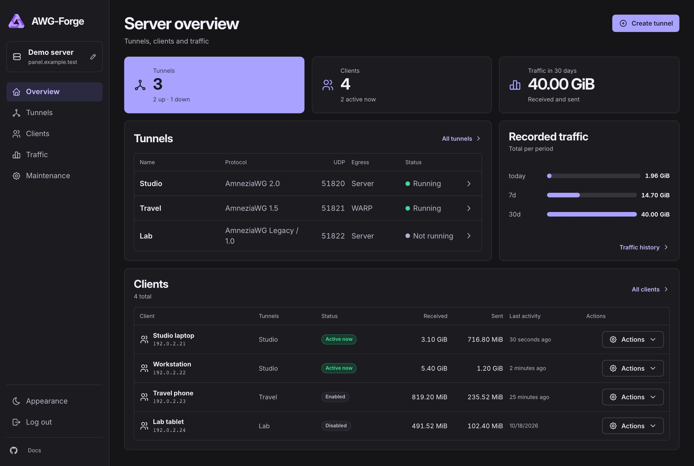

# AWG-Forge

[README на русском](README.md)

Manage AmneziaWG on your own server. One Docker image includes the web interface, CLI, and tools to run tunnels.



## Features

- **Multiple tunnels on one VPS.** Each tunnel has its own AmneziaWG profile, UDP port, subnet, and connection settings.
- **IPv4 routing.** Choose direct server egress or Cloudflare WARP for each tunnel.
- **Client management.** Enable or disable clients, set expiration dates, and configure traffic limits. Export `.conf` files, AmneziaWG or AmneziaVPN QR codes, and `vpn://` links.
- **Monitoring.** View last handshakes, counters, and traffic history. History and limits require SQLite.
- **Panel access.** Use an SSH tunnel or HTTPS with your own certificate, an automatic certificate for a domain or public IP, or a reverse proxy.
- **Maintenance.** Run Doctor, repair managed firewall rules, review the audit log, and export a support bundle without secrets.
- **Encrypted backups.** Create and verify backups in the panel and restore them through the CLI.

Supported profiles include Legacy / 1.0, 1.5, and 2.0. New installations use AmneziaWG 2.0 by default. AWG 3.x is experimental. [Compatibility matrix](docs/en/protocol-matrix.md)

## Quick install

Installation requires an x86_64 Linux server or VPS with `/dev/net/tun` available.

```bash
curl -fsSL https://raw.githubusercontent.com/astronaut808/awg-forge/master/install.sh -o install.sh
chmod +x install.sh
sudo ./install.sh
```

The installer offers to prepare missing dependencies, creates the first tunnel, and prints the password and the command to access the panel. [Requirements and post-install steps](docs/en/quick-install.md)

The panel listens on `127.0.0.1:51821` by default. Open an SSH tunnel from your computer. Replace `user@server` with your username and server address.

```bash
ssh -L 51821:127.0.0.1:51821 user@server
```

Then open [the panel in your browser](http://127.0.0.1:51821) and enter the password printed by the installer.

## Documentation

- [Manual installation and startup](docs/en/setup.md)
- [Upgrade](docs/en/quick-install.md#upgrade) · [Uninstall](docs/en/quick-install.md#uninstall)
- [Configuration, Web UI, CLI, and diagnostics](docs/en/README.md)
- [Development](docs/en/development.md) · [Contributing](CONTRIBUTING.md)
- [Changelog](CHANGELOG.md) · [Security policy](SECURITY.md)

## Support the project

- USDT (TRC20): `TBQcgJ9UoGEBXBwPMcf97t3uJiTCRnVmji`
- GRAM (ex TON): `UQCrUmIsUBgIJJJNKpvOO5dxpUH5r7xCz9-AJ2IHUTIckJhS`

## Project independence

AWG-Forge is an independent open-source project. It is not affiliated with Amnezia.org and is not developed or supported by the Amnezia team. The AmneziaWG name describes compatibility with the protocol and tools.

## License

[MIT](LICENSE)
