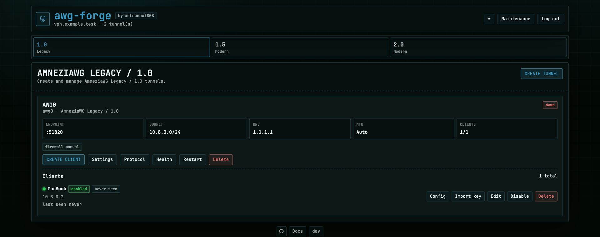

# AWG-Forge

[English README](README.en.md)

Панель управления AmneziaWG на своём сервере: Web UI, CLI и VPN runtime в одном Docker-образе.



## Возможности

- **Несколько туннелей на одном VPS:** отдельные профили AmneziaWG, порты и подсети.
- **Маршрутизация для каждого туннеля:** IPv4-трафик через сервер или Cloudflare WARP.
- **Клиенты и импорт:** управление доступом, сроки и лимиты трафика; `.conf`, QR-коды и `vpn://`.
- **Мониторинг:** последнее подключение клиентов, счётчики и история трафика.
- **Доступ к панели:** SSH-туннель или HTTPS — свои сертификаты, автоматические сертификаты для домена/IP, reverse proxy.
- **Зашифрованные резервные копии:** создание и проверка в панели, восстановление через CLI.
- **Диагностика и обслуживание:** Doctor, восстановление firewall, журнал событий и диагностический архив без секретов.
- **Установка и обновление:** интерактивный скрипт с подготовкой зависимостей и проверками.
- **Контроллер и узлы (`develop`):** вход с MFA и просмотр состояния подключённых серверов без удалённых изменений.

AmneziaWG 2.0 используется по умолчанию. AWG 3.x — экспериментальный профиль;
совместимость и ограничения описаны в [матрице профилей](docs/ru/protocol-matrix.md).
История трафика и лимиты доступны при включённом SQLite. Панель по умолчанию слушает только локальный адрес.

## Быстрая установка

На Linux/VPS (x86_64):

```bash
curl -fsSL https://raw.githubusercontent.com/astronaut808/awg-forge/master/install.sh -o install.sh
chmod +x install.sh
sudo ./install.sh
```

Установщик подготовит зависимости, создаст первый туннель и покажет пароль и команду
для доступа к панели. [Требования и дальнейшие шаги](docs/ru/quick-install.md).

## Документация

- [Установка и ручной запуск](docs/ru/setup.md)
- [Обновление](docs/ru/quick-install.md#обновление) · [Удаление](docs/ru/quick-install.md#удаление)
- [Конфигурация, Web UI, CLI и диагностика](docs/ru/README.md)
- [Разработка](docs/ru/development.md) · [Участие в проекте](CONTRIBUTING.md)
- [История изменений](CHANGELOG.md) · [Политика безопасности](SECURITY.md)

## Поддержать проект

- USDT (TRC20): `TBQcgJ9UoGEBXBwPMcf97t3uJiTCRnVmji`
- GRAM (ex TON): `UQCrUmIsUBgIJJJNKpvOO5dxpUH5r7xCz9-AJ2IHUTIckJhS`

## Независимость проекта

AWG-Forge — независимый open-source проект, не аффилированный с Amnezia.org
и не разрабатываемый или поддерживаемый командой Amnezia. Название AmneziaWG
обозначает совместимость с протоколом и инструментами.

## Лицензия

[MIT](LICENSE)
