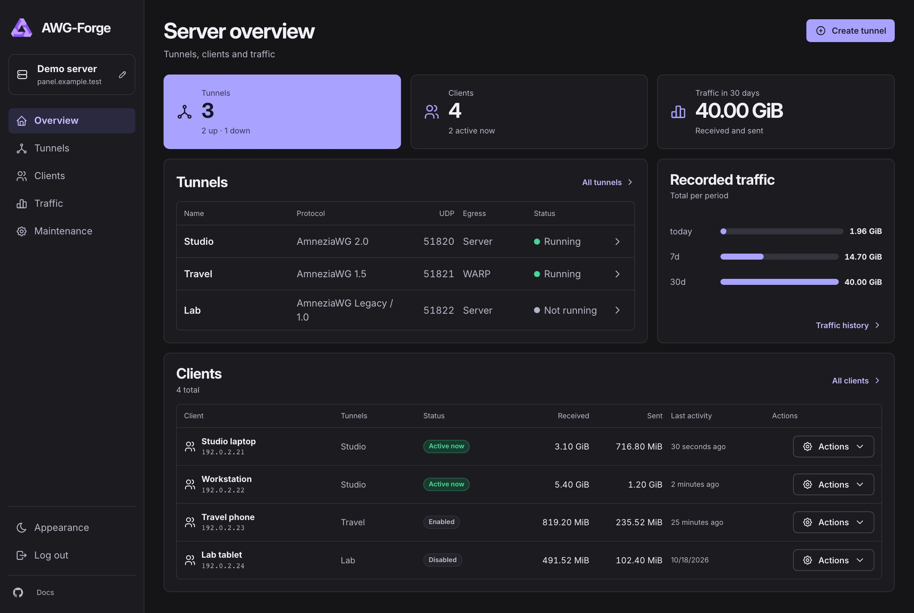

# AWG-Forge

[English README](README.en.md)

Панель управления AmneziaWG на своём сервере. В одном Docker-образе есть веб-интерфейс, CLI и инструменты для запуска туннелей.



## Возможности

- **Несколько туннелей на одном VPS.** У каждого свой профиль AmneziaWG, UDP-порт, подсеть и настройки подключения.
- **Маршрутизация IPv4.** Для каждого туннеля можно выбрать выход через сервер или Cloudflare WARP.
- **Управление клиентами.** Настройка доступа, срока действия и лимита трафика. Конфигурацию можно скачать в формате `.conf`, открыть как QR-код для AmneziaWG или AmneziaVPN либо скопировать как ссылку `vpn://`.
- **Мониторинг.** Время последнего рукопожатия, счётчики и история трафика. Для истории и лимитов нужен SQLite.
- **Доступ к панели.** SSH-туннель или HTTPS с собственным сертификатом, автоматическим сертификатом для домена или публичного IP либо через обратный прокси.
- **Обслуживание.** Doctor, восстановление управляемых правил файрвола, журнал событий и диагностический архив без секретов.
- **Зашифрованные резервные копии.** Создание и проверка в панели, восстановление через CLI.

Поддерживаются Legacy / 1.0, 1.5 и 2.0. Новые установки используют AmneziaWG 2.0 по умолчанию. AWG 3.x — экспериментальный профиль. [Матрица совместимости](docs/ru/protocol-matrix.md)

## Быстрая установка

Для установки нужен Linux-сервер или VPS с архитектурой x86_64 и доступным `/dev/net/tun`.

```bash
curl -fsSL https://raw.githubusercontent.com/astronaut808/awg-forge/master/install.sh -o install.sh
chmod +x install.sh
sudo ./install.sh
```

Установщик предложит подготовить недостающие зависимости, создаст первый туннель, покажет пароль и команду для доступа к панели. [Требования и шаги после установки](docs/ru/quick-install.md)

По умолчанию панель слушает `127.0.0.1:51821`. На своём компьютере открой SSH-туннель. Замени `user@server` на своё имя пользователя и адрес сервера.

```bash
ssh -L 51821:127.0.0.1:51821 user@server
```

Затем открой [панель в браузере](http://127.0.0.1:51821) и введи пароль, который показал установщик.

## Документация

- [Ручная установка и запуск](docs/ru/setup.md)
- [Обновление](docs/ru/quick-install.md#обновление) · [Удаление](docs/ru/quick-install.md#удаление)
- [Конфигурация, Web UI, CLI и диагностика](docs/ru/README.md)
- [Разработка](docs/ru/development.md) · [Участие в проекте](CONTRIBUTING.md)
- [История изменений](CHANGELOG.md) · [Политика безопасности](SECURITY.md)

## Поддержать проект

- USDT (TRC20): `TBQcgJ9UoGEBXBwPMcf97t3uJiTCRnVmji`
- GRAM (ex TON): `UQCrUmIsUBgIJJJNKpvOO5dxpUH5r7xCz9-AJ2IHUTIckJhS`

## Независимость проекта

AWG-Forge — независимый проект с открытым исходным кодом. Он не аффилирован с Amnezia.org, не разрабатывается и не поддерживается командой Amnezia. Название AmneziaWG обозначает совместимость с протоколом и инструментами.

## Лицензия

[MIT](LICENSE)
